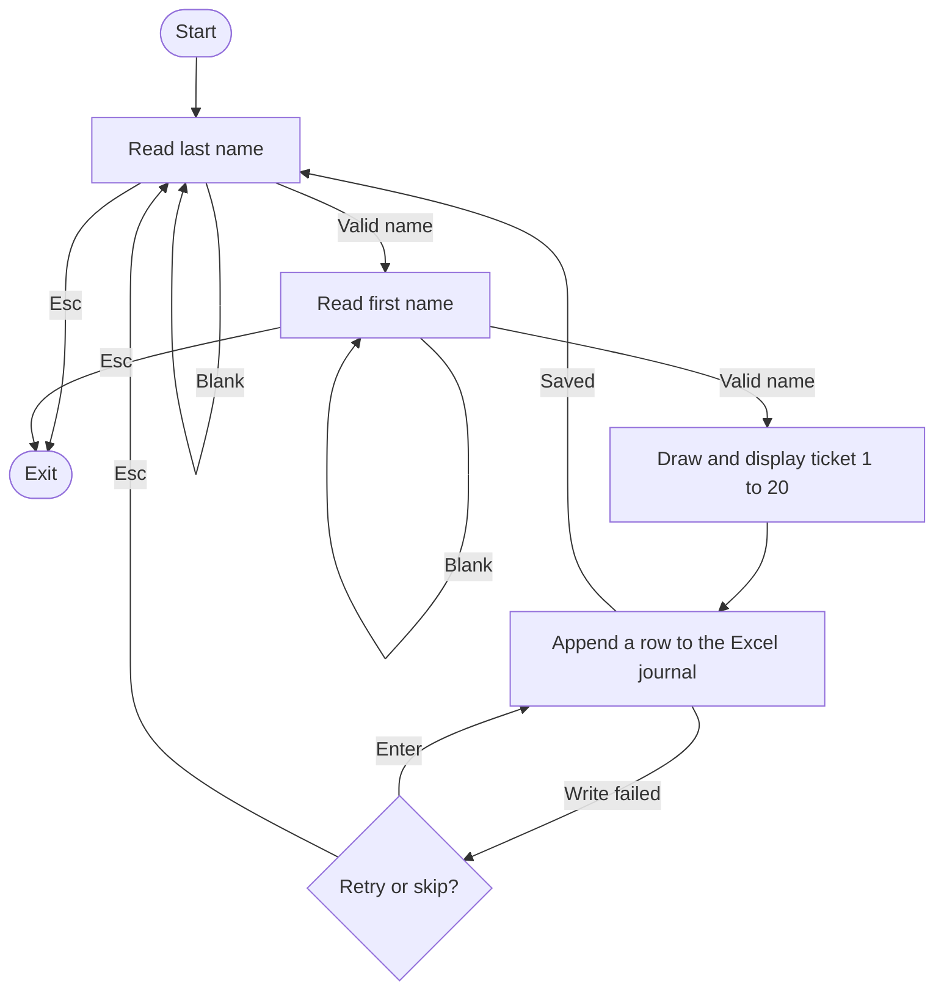
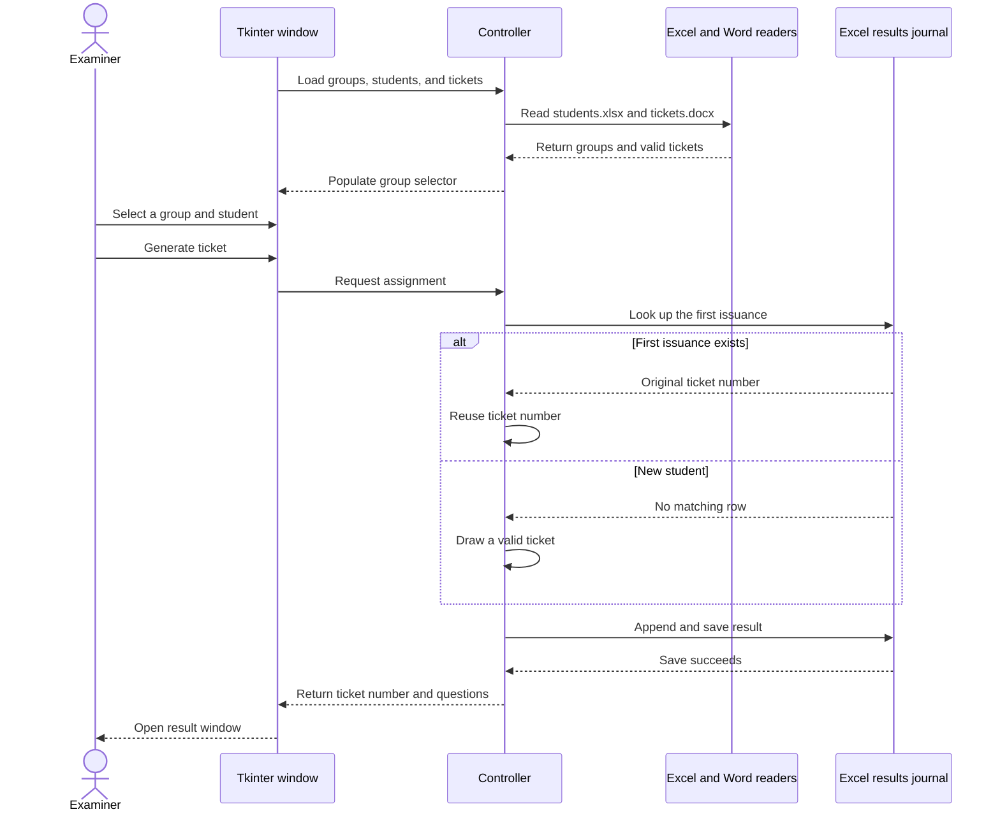

# Exam Ticket Generator

Two Software Engineering lab assignments share this repository.

| Lab | Application | Entry point |
| --- | --- | --- |
| 1 | Command-line ticket generator with an Excel journal | `python -m lab1` |
| 2 | Tkinter ticket generator that reads students from Excel and questions from Word | `python -m lab2` |

## Setup

Use Python 3.10 or later. The applications were tested with Python 3.14 on Windows 11.

```powershell
python -m venv .venv
.\.venv\Scripts\Activate.ps1
python -m pip install -r requirements.txt
```

## Lab 1 — Command-line ticket generator

```powershell
python -m lab1
python -m lab1 --journal D:\journal.xlsx
```

The application asks for a student’s last and first names, draws a random ticket from 1 to 20, and appends the name, ticket number, and local date and time to `lab1/journal.xlsx`. Use `--journal` to change the output path. Run the application in a terminal so it can detect Esc during either name prompt.



| Module | Responsibility |
| --- | --- |
| `lab1/app.py` | Runs the input, ticket draw, and journal loop |
| `lab1/console_input.py` | Reads individual keystrokes and handles Enter, Backspace, and Esc |
| `lab1/journal.py` | Creates the workbook and saves each new row |

Names are stored as text, including inputs such as `=1+1`. Each append writes a temporary workbook in the journal directory, flushes it with `fsync`, and replaces the original with `os.replace`. If Excel has locked the journal, close it and press Enter to retry, or press Esc to skip that row. A damaged workbook is left in place with an error message. Use one application instance per journal to avoid concurrent writes overwriting one another.

## Lab 2 — Desktop ticket generator

```powershell
python -m lab2
python -m lab2 --data-dir D:\exam-data
```

By default, the app reads and saves files in `lab2/data/`. Use `--data-dir` to select a different directory.

| File | Format |
| --- | --- |
| `students.xlsx` | One worksheet per group. Row one contains the headers, with last and first names in columns A and B. The sample contains three groups, including the empty group `ИТ-43`. |
| `tickets.docx` | A ticket heading such as `Билет 1` followed by three numbered questions. The parser supports Word list numbering, paragraphs in tables, and soft line breaks. The sample contains ten tickets. |
| `results.xlsx` | One row per issuance, with group, last name, first name, ticket number, local date and time, and a repeat flag (`да` or `нет`). |
| `lab2.log` | Parsing and application events. |

Run `python tools/make_sample_data.py` to regenerate the sample inputs.

Select a group and a student to enable ticket generation. For a first issuance, the app randomly selects a valid ticket. For a repeat, it reuses the number from the first journal entry for the same group and name, ignoring case and surrounding whitespace. Each issuance adds a new row before the result window opens. Use **Закрыть (Esc)** or press Esc to close the result and return to the form.



### Error handling

| Situation | Behavior |
| --- | --- |
| Missing or unreadable input | The app shows an error and offers to reload the input files. Ticket generation stays disabled. |
| Empty group | The student selector and generate button stay disabled. |
| Invalid ticket heading, duplicate number, or fewer than three questions | The parser skips the ticket, records the error, and continues. |
| More than three questions | The parser keeps the first three and logs a warning. |
| Results journal locked by Excel | The app offers to retry after the workbook is closed. Cancel leaves the ticket unissued. |
| Damaged results journal | The app reports the problem and preserves the workbook. |
| Previously assigned number is absent from the current Word document | The result shows the original number and explains that its questions are unavailable. |

The results journal uses the same atomic save procedure as Lab 1. It stores group and name fields as text.

| Module | Responsibility |
| --- | --- |
| `lab2/students.py` | Reads group sheets and student names |
| `lab2/tickets.py` | Parses ticket headings and questions from Word |
| `lab2/results.py` | Looks up first issuances and appends journal rows |
| `lab2/controller.py` | Tracks selections and assigns tickets |
| `lab2/ui.py` | Presents the selection form, dialogs, and ticket window |

The development workflow started with an [English implementation prompt](docs/lab2_prompt_en.md), then added file readers, the controller, the interface, and tests. The `lab2-ui-tickets` branch was merged into `main` through a pull request.

## Tests

```powershell
python -m pytest
```

Lab 1 tests cover key handling, input validation, ticket generation, and immediate journal writes across sessions and during failures. Lab 2 tests cover parsing, group selection, repeat assignments, journal errors, and interactions with real Tkinter widgets.

### Manual checks

1. Enter three students in Lab 1, exit with Esc, and verify that the journal contains three data rows. Restart, add two more, and verify that the original rows remain in place.
2. Force-close the Lab 1 terminal after a save and reopen the journal. Confirm that the saved row is present.
3. Try to issue a ticket with the corresponding journal open in Excel. Close the workbook and retry.
4. In Lab 2, select a group and student, generate a ticket, and close the result with Esc. Issue again and check that the same number is recorded in a new row marked `да`. Verify that the empty sample group keeps generation disabled.

The original verification included opening both journals in Microsoft Excel through COM to exercise the file-locking behavior.

## AI assistance

Claude Code (Claude Opus 5.5) generated the original implementation, tests, and documentation from the lab assignments. The author chose the language and repository and handled publication. The instructor allowed Claude Code for the prompt, implementation, and test steps.

Review of the original implementation led to fixes for damaged journals, Excel formula interpretation, Windows keyboard input, Tkinter test setup, and Word parsing of tables, soft breaks, decimal numbers, and removed numbering. The follow-up refreshed the Lab 2 interface and added the diagrams above.
